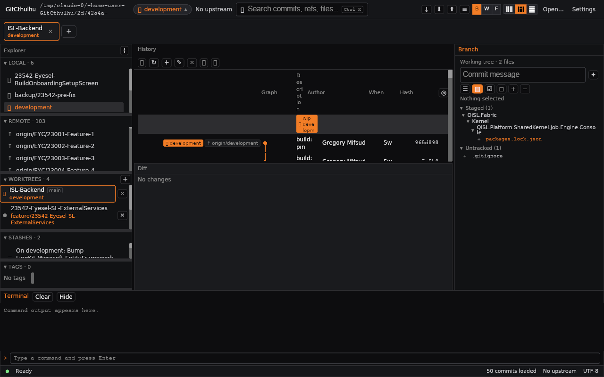
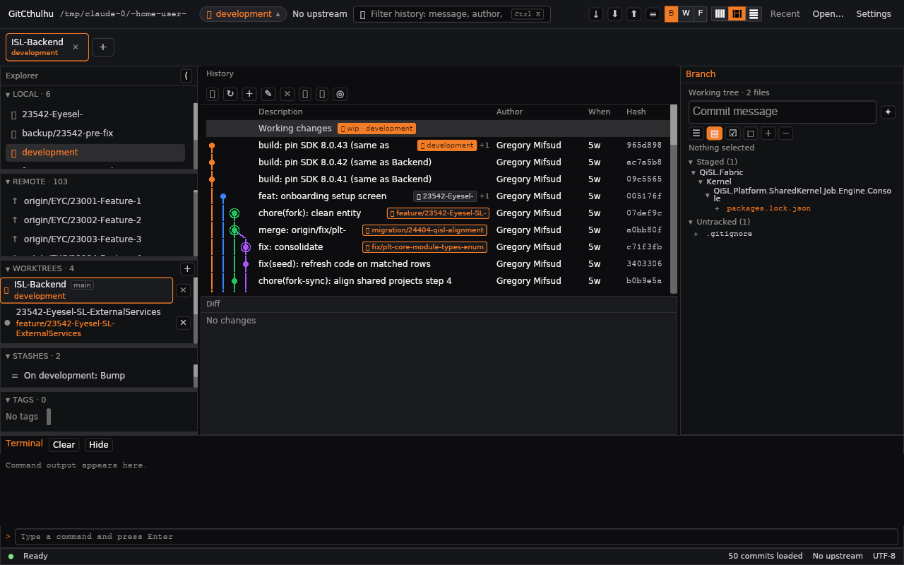
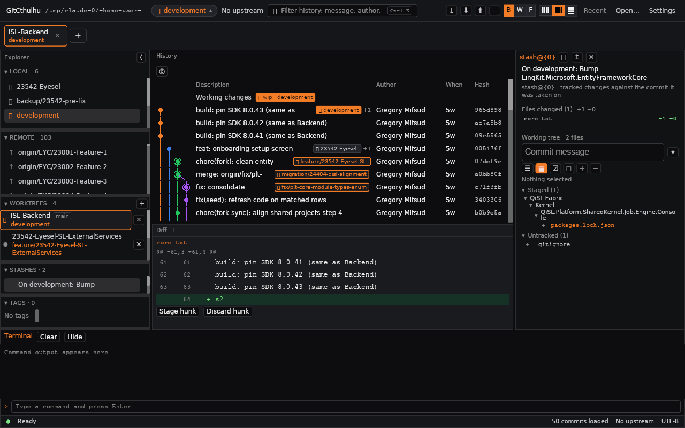
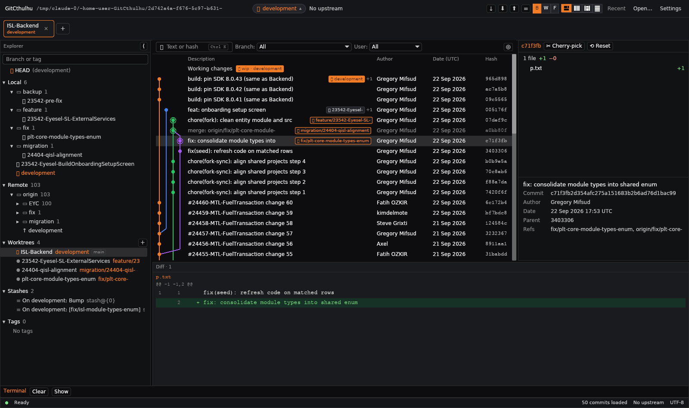
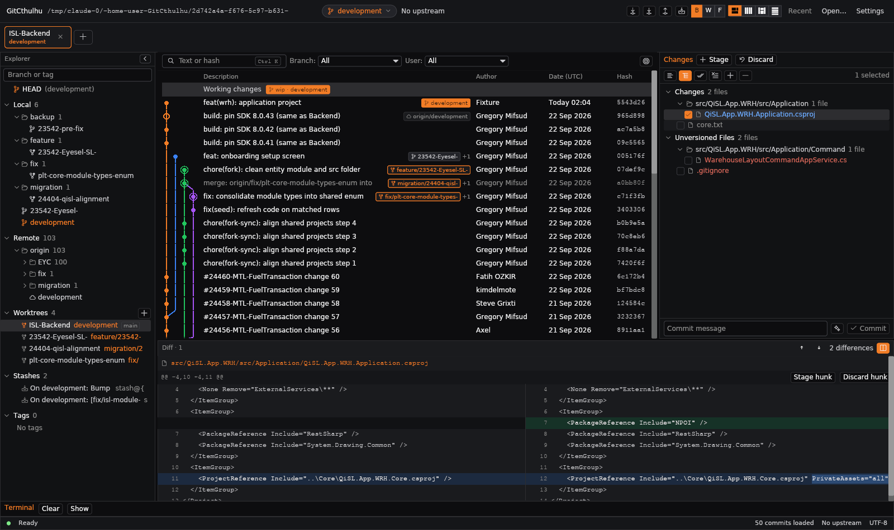
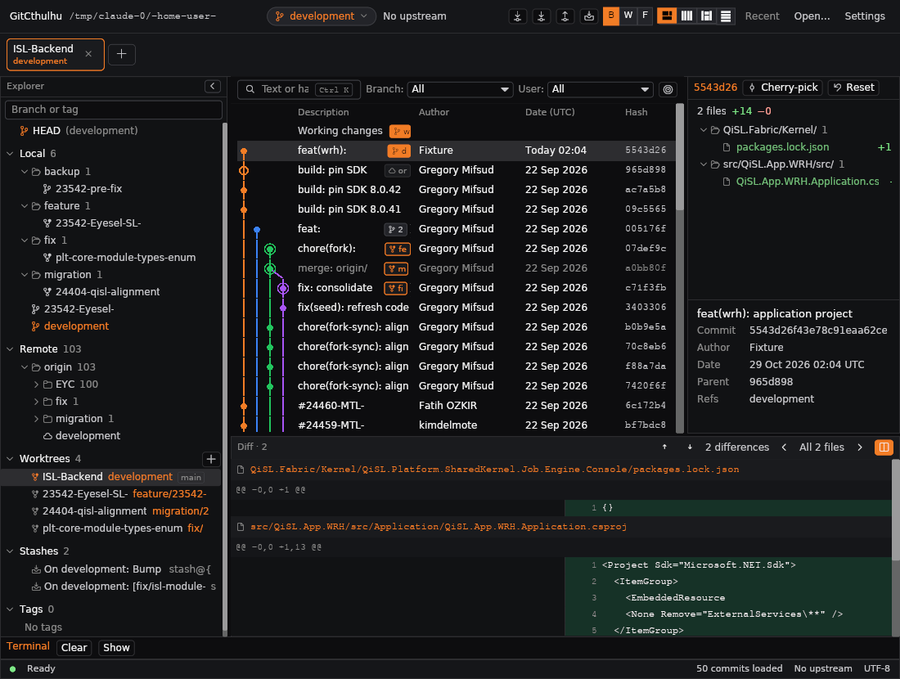
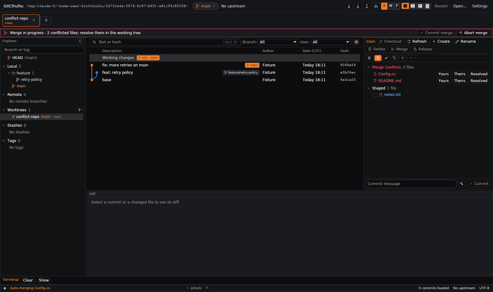
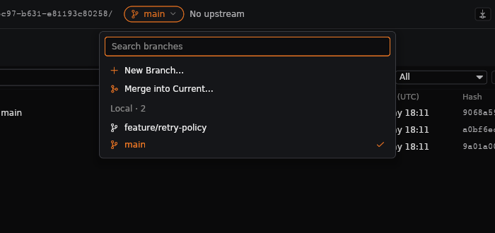
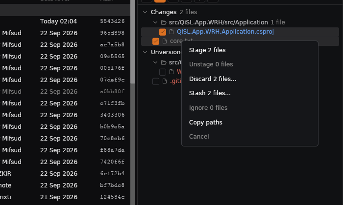

# GitCthulhu flow analysis

## Verdict: Needs Attention

GitCthulhu has most of the *parts* of a Git client: refs, graph, diff, staging, worktrees, stashes, sync. What it lacks is the *flows* that join them. Seven structural causes explain almost every complaint (R1–R7 below). The bugs you reported are symptoms of them.

Fixed on the branch today: #1 stash, #2 search, #3–#5 graph space and the focus toggle. #6 (flow) needs the decisions in §6. The redesign in §5 is a proposal for sign-off under the PRD-first rule, **not yet built**.

> **Deployment note.** The build in your screenshot is `origin/main` (6eda178). Every GUI fix since then is on `feature/blissful-goldberg-rsnvfh`, which is not merged. That is why "search disabled" persisted.

## 1. Evidence

| Build | History on the same repository |
|---|---|
| `origin/main` |  |
| branch (6dd913a) |  |
| branch, stash selected |  |

On `main`, Description is about 20 px wide and its header wraps one fragment per line. With your real repository's extra lanes, that header grows until every commit row falls below the fold: the "empty" History in your screenshot.

## 2. Anatomy today

| Region | Share of a 1280×800 window | Purpose | Problem |
|---|---|---|---|
| Top bar | 40 px | Path, branch chip, search, sync, layout toggles, Open/Settings | Path wraps (fixed); sync buttons are unlabelled glyphs |
| Tab strip | ~50 px | Worktree tabs | Fine; costs a full row even with one tab |
| Explorer | ~22 % width | LOCAL, REMOTE, WORKTREES, STASHES, TAGS | Five small fixed scrollers. 103 remotes in a flat list, about 3 visible at once; no filter; no folder grouping (`EYC/`, `MTL/`…) |
| History | ~50 % width × **~35 % height** | Graph and commits | The only thing you read continuously, yet it gets about a third of the height |
| Diff | below History | Patch of the selection | Takes about 25 % of the window permanently, even when it shows "No changes" |
| Inspector | ~25 % width | Selection label + commands + working tree + commit/stash files | Always shows the working tree, whatever is selected; a commit's files sit below the commit box |
| Terminal | ~130 px, open by default | Shell + AI transcript | Raw provider JSON (your screenshot); permanent height cost |
| Status bar | 24 px | State, page size, upstream | "50 commits loaded" is the whole history the app will ever show |

About **40 % of the window is chrome or idle panes** at any moment (tabs, empty Diff, terminal, five nested scroll areas).

## 3. Journey audit

Severity: **H** blocks or misleads, **M** slows, **L** polish.

### J1 Orient: "Where am I, what changed, is anything in progress?"
| Step | Today | Severity |
|---|---|---|
| Current branch and upstream | Chip + "Up to date with origin/development" ✅ | — |
| Merge/rebase/cherry-pick in progress | **Invisible.** The app never reads `MERGE_HEAD`, `REBASE_HEAD`, `rebase-merge/` or `CHERRY_PICK_HEAD`. After a conflicted merge you see only git's message | **H** |
| Conflicted files | Not listed as conflicted (CONTEXT.md: "not listed file by file yet") | **H** |

### J2 Inspect history: commit → files → diff
| Step | Today | Severity |
|---|---|---|
| Scan commits | 50 commits, then nothing. No paging, no "load more" | **H** |
| Find a commit | Search covers only those 50 (fixed today, still bounded) | M |
| Read a merge commit | Showed git's combined diff, usually **empty** (fixed today: first-parent) | **H**, fixed |
| Navigate with the keyboard | ↑/↓ do not move the selection in History | M |
| Branch → its commits | Clicking a branch selects it but shows **nothing** about it (no tip, no ahead/behind list, no scroll) | **H** |

### J3 Change: edit → stage → commit → push
| Step | Today | Severity |
|---|---|---|
| See working changes | WIP row + Inspector tree ✅ | — |
| Review a file | Click the file, and the diff appears in a different pane (centre) from the list (right) | M |
| Stage a hunk | Only from the Diff pane | — |
| **Safety** | Hunk buttons appeared on commit and stash diffs. "Discard hunk" reverse-applied *that commit's* hunk to the working tree (silent undo of HEAD's change) | **H**, fixed today |
| Commit | Message box at the top of the Inspector ✅ | — |
| Push | Unlabelled glyph in the top bar (↑ vs ⬆ for pull/push) | M |

### J4 Integrate: fetch / pull / merge / rebase → conflicts → continue
| Step | Today | Severity |
|---|---|---|
| Merge / rebase | Confirm dialogs ✅ | — |
| Conflict | Git's message in the status bar; nothing to resolve with | **H** (the Cthulhu Resolve CLI is the planned remedy) |
| Continue / abort | No UI | **H** |

### J5 Switch context: branch / worktree / stash
| Step | Today | Severity |
|---|---|---|
| Find a branch | Scroll a 3-row list, or Ctrl+P (added today) | M |
| Worktrees | Tabs + catalogue ✅ (the strongest flow in the app) | — |
| Stash | Selecting showed nothing; the list could fail on some git configs (fixed today) | **H**, fixed |

## 4. Root causes

| # | Cause | Symptoms it explains |
|---|---|---|
| **R1** | **Every pane is always on; there are no modes.** Inspect and Change share one fixed five-region layout | Squeezed history; idle Diff; "space everywhere" (#3, #4) |
| **R2** | **Shallow selection model.** One `Selection` drives everything, but Branch/Remote/Stash had no content and the Inspector always prepends the working tree | Stash showed nothing (#1); branch click does nothing; the Inspector reads the same whatever is selected |
| **R3** | **Commands scattered over four surfaces** (top bar, History toolbar, Inspector head, context menus), mostly unlabelled glyphs with a 2 s tooltip delay | "Flow not there"; focus toggle "gone" when its host overflowed (#5) |
| **R4** | **Truncated data.** Fixed 50-commit page, search over loaded commits only, flat remote list | History feels shallow; finding things requires Ctrl+P |
| **R5** | **Rendering defect upstream.** iced_graphics 0.13.0 ignores `Wrapping::None`, so any squeezed cell wraps and grows. No layout rule protected the primary column | Header collapse, two-line explorer rows, path wrapping (#3) |
| **R6** | **No operation awareness.** In-progress merge/rebase/cherry-pick/revert and conflicted paths are not modelled | J1/J4 dead ends |
| **R7** | **Terminal doubles as a debug log.** Provider exchanges are dumped verbatim | Raw JSON on screen; terminal "needed" open |

## 5. Proposed flow model (for sign-off)

A tourist map, not a final design: two modes over one stable frame, plus an operation banner.

```
┌ Top bar: repo ▾ (recent) · branch ▾ · ↓Fetch ↓Pull ↑Push (counts) · [ search / Ctrl+K ] · ⌘ Ctrl+P ┐
├ Operation banner (only when a merge/rebase/cherry-pick is in progress):                            ┤
│   REBASE 3/7 onto origin/development · 2 conflicted files  [Resolve…] [Continue] [Abort]          │
├──────────────┬─────────────────────────────────────────────┬──────────────────────────────────────┤
│ Refs (one    │  LOG MODE (default)                         │ Details of the selection             │
│ scroll,      │  History full height, paged 200 at a time,  │  commit: message, meta, files ▸      │
│ filter box,  │  ↑/↓ moves selection, Enter = open diff     │  branch: tip + ahead/behind lists    │
│ folders by   │                                             │  stash: files ▸   (no working tree)  │
│ prefix)      │  CHANGES MODE (Ctrl+1/Ctrl+2 or the WIP row)│ Working tree + commit box            │
│              │  files list ▸ diff side by side             │  (only in Changes mode)              │
├──────────────┴─────────────────────────────────────────────┴──────────────────────────────────────┤
│ Diff opens *in place of* History (Log mode) or beside the file list (Changes mode); Esc returns.  │
│ Terminal: collapsed by default (Ctrl+`); AI exchanges go to a log file, not the terminal.         │
└───────────────────────────────────────────────────────────────────────────────────────────────────┘
```

Principles:
1. **The primary column owns the space.** History, or the Diff when one is open, is never squeezed by secondary panes. The Diff appears on demand instead of always reserving height.
2. **The selection decides the Inspector.** One block per selection kind. The working tree appears only for the working-tree selection or in Changes mode.
3. **One command surface per scope.** Repository sync lives in the top bar with labels and counts. Selection commands appear in the Inspector header with labels. Everything is also in the Ctrl+P palette, with actions under a `>` prefix.
4. **State before action.** The operation banner makes in-progress Git state visible, and it is the entry point to Cthulhu Resolve.
5. **Bounded rendering.** Every single-line cell uses `one_line` until iced 0.14 removes the need.

## 6. Decisions needed (ranked)

| # | Decision | Recommendation | Why |
|---|---|---|---|
| D1 | Merge the branch into `main` now? | **Yes, via a PR** | Your running build is missing every fix since 6eda178 |
| D2 | Adopt Log/Changes modes (§5) | **Yes** | Removes R1 without a new framework; reuses pane_grid presets |
| D3 | Terminal collapsed by default, AI exchanges moved to a log file | **Yes** | Recovers about 130 px; R7 |
| D4 | History paging (200 per page, load on scroll) plus full-history search via `git log --grep/--author/-S` in the background | **Yes** | R4. Search over 50 commits is not search |
| D5 | Operation banner + conflicted-file list (detect state via `git rev-parse --git-path` + porcelain v2 `u` entries) | **Yes, before the resolver UI** | R6. It is also the integration point for Cthulhu Resolve |
| D6 | iced 0.14 upgrade | **Later, as its own work package** | Removes R5's workaround; breaking API changes across `gui_app` |

## 7. Backlog (in order; effort S ≈ ≤1 day, M ≈ 2–3 days, L ≈ a week)

| # | Item | Fixes | Effort | Acceptance |
|---|---|---|---|---|
| 1 | PR the branch to `main` | D1 | S | `main` shows "Filter history…" and Recent |
| 2 | Operation detection + banner + conflicted list | R6, J1, J4 | M | Given a conflicted rebase, the banner shows step, onto and conflicted count; Continue stays disabled until all paths are staged |
| 3 | History paging + ↑/↓/Enter navigation | R4, J2 | M | 1,000-commit repo: scrolling to the end loads pages and the frame stays under 16 ms |
| 4 | Selection-driven Inspector (branch tip + ahead/behind; no working tree for commit/stash) | R2 | M | Clicking a local branch shows its tip and its commits not in HEAD |
| 5 | Log/Changes modes; Diff on demand; terminal collapsed by default | R1, D2, D3 | L | At 1280×800, History shows ≥ 20 rows in Log mode |
| 6 | Explorer as one scroll with filter + prefix folders | R4, J5 | M | 103 remotes fold under `EYC/`, `EBS/`, `MTL/`; typing filters every section |
| 7 | Labelled commands; palette actions (`>` prefix) | R3 | M | Every command reachable from Ctrl+P |
| 8 | "Resolve conflicts…" opens Cthulhu Resolve (CLI contract) | J4 | S once the resolver exists | — |
| 9 | iced 0.14 upgrade; remove `one_line` | R5, D6 | L | No height-clamp workarounds left |

## 8. Fixed in this pass (branch `6dd913a`)

| Report | Root cause | Fix |
|---|---|---|
| #1 Stash | No Stash arm in `patch_query`; no stash block in the Inspector; human-format `stash list` parsing | Stash loads its first-parent diff and its files are listed; explicit `--format`; `Stash.commit_id` |
| (found) Merge commits empty | `git show` combined diff | `-m --first-parent` |
| (found) Hunk discard on commits | Missing selection guard | View and reducer allow hunk edits on working-tree files only; tested |
| #2 Search | Not merged to `main` (fixed on the branch yesterday) | See D1 |
| #3/#4 Graph space | 260 px gutter + unbounded lanes + iced wrap defect | Gutter removed, lanes capped at 10, header clamped, one pill + "+N", History 62 % of the split |
| #5 Focus toggle | Last header cell, clipped by overflow | Moved to the History toolbar |

## 9. JetBrains Log pass

Request: replicate the JetBrains Git log, use the space better, make the buttons useful, and allow branching from a remote and managing worktrees from the right-click menu.



| Report | Root cause | Fix |
|---|---|---|
| Cannot branch from a remote | `confirm_branch` accepted only local branch names as a start point, so a remote start failed with "That branch is no longer there" | `start_point_exists` accepts HEAD, local and remote branches, tags, stashes and loaded commits. The dialog has a Checkout branch box |
| No right-click menu for remotes or worktrees | `ContextTarget` covered commits and local branches only | Targets for remote branches, tags, stashes and worktrees, each with its own menu (§ CONTEXT "Branch tree") |
| A click in the Explorer checked a branch out | The row sent `ChooseBranch` | Click filters the log to that branch; a double-click (400 ms, decided in the reducer) checks out a local branch |
| Space not used well | A three-column preset with a stacked Inspector over the Diff; terminal open by default; relative "5w" dates | `LayoutPreset::Log` is the default: tree, History and Inspector on top, and a full-width Diff below. Terminal collapsed. Full dates |
| Unhelpful buttons | Glyph-only buttons on the History head | The History head is a filter bar (text, Branch ▾, User ▾, current-branch toggle). Selection commands moved to the Inspector head as labelled buttons, and they are on every right-click menu too |
| Inspector showed the working tree for a commit | The working tree block was drawn whenever the tree was dirty | Commit, tag and stash show a changed-files tree and details. The working tree only appears for working-tree selections |

Backlog effect: item 6 is done, item 4 is done for commits, tags and stashes (a branch tip with its ahead/behind lists is still open), and item 7 is done for the Inspector head (palette actions are still open).

Assumptions:
- **Dates are shown in UTC.** `gui_app` has no time-zone source, and adding `chrono` for local time is left as its own decision.
- **The User ▾ list only covers loaded commits.** It inherits the loaded-history limit (R4).

## 10. Testing round 2 (after the merge to `main`)





| # | Report | Root cause | Fix |
|---|---|---|---|
| 1 | Icons missing | Icons were Unicode symbols drawn from whichever fonts the machine had. Segoe UI Symbol has no `⤵ ⑂ ⤴ ⌕`, and the labelled buttons drew the mark in the text font | Codicons is bundled and loaded at startup (`icons.rs`). Every icon is an `Icon` variant, and a test checks each codepoint against the font's `cmap` |
| 2 | Working-tree buttons scroll away | The whole panel (commit box, toolbar, files) was inside one `scrollable` | The toolbar and commit box are pinned; only the file list scrolls |
| 3 | Right-click jumps the scroll | `view()` returned a `container` normally and a `stack` while a menu was open. iced keeps widget state by tree position, so every scrollable reset. Dialogs replaced the root too | The root is always `stack![main, layer]`. Dialogs are an `opaque` layer above the screen instead of replacing it |
| 4 | No colour in the changes list | The adapter folded every gix `Summary` into a path list, so the change kind never reached the UI | `ChangeKinds` in `RepoStatus`, filled from the index↔HEAD comparison and from gix's index↔worktree summary. JetBrains colours, folder joining, file counts. Commit files are coloured from their hunk ranges |
| 5 | Diff hard to read | A unified list with no pairing, no word marking and no navigation | `diff_view`: side-by-side pairing, token-level LCS marking of changed words (prefix/suffix above 40,000 token pairs), difference and file stepping, unified toggle |
| 6 | Inconsistent on resize | Panes were fixed fractions, so the Explorer shrank with the window. Pickers grew to their longest option and crushed the search box. Text still wrapped when squeezed (iced 0.13 ignores `Wrapping::None`) | Explorer pixel width kept across resizes. Fixed-width pickers. `one_line` clamps on tags, labels and tracking text. Ref pills take at most a quarter of the Description column |

Found during verification: `rich_text` showed the same wrap defect. A modified diff row lost everything after its first highlighted word. The row is drawn as one text widget per piece instead.

Not done:
- Horizontal scrolling of long diff lines (they clip at the column edge).
- A conflict view.

## 11. Basic operations round (2026-10-29)

Report: icons still missing in the latest build; branching, selecting files, staging from the right-click menu, discarding, stashing and merging are all hard.

**Why the icons were still missing:** `main` was at the earlier merge (`adbbf97`). The icon-font commit (`09a74fa`) was only on the feature branch. A build from `main` is still the build with system-font icons until the branch is merged again.



| Operation | Root cause | Fix |
|---|---|---|
| Branching out | The top-bar branch chip only expanded the Explorer. New branch was behind a selection plus a head button or a right-click | Branches popup on the chip: search, New Branch…, Merge into Current…, every branch with its menu  |
| Selecting files | One focused file. Check boxes were a separate concept. No Ctrl- or Shift-click | One selection: click, Ctrl-click, Shift-click over the drawn order (`changes::visible_files`, `selection_range`). Modifiers come from `ModifiersChanged` |
| Stage or discard via right-click | The menu acted only on the clicked row; discard took one path and one place | `ContextTarget::Changes` acts on the selection with per-action counts. Discard takes (path, place) pairs, so staged and unstaged files go together  |
| Stash | `stash_push("")`: no message, no untracked option | Stash dialog: message, include untracked, or the selected files only. The port's `stash_push` takes `include_untracked` |
| Merge | `git merge --no-ff` run blind; a conflict was an error string with the repo left mid-merge and nothing in the UI knew | Merge dialog (branch picker, optional `--no-ff`). `RepoStatus.operation` from gix's `repo.state()`. `conflicted_files` from index stages 1–3. Port `abort_operation`, `continue_operation` and `resolve_conflict`. Operation bar with Commit/Continue and Abort. Merge Conflicts section with Yours/Theirs/Resolved. Git's conflict output is replaced by one plain sentence |

**Bug found and fixed:** a conflicted path was reported as a staged deletion. `staged_changes` compared stage-0 entries only, and a conflicted path has none.

**Verified end to end** on a two-branch fixture, using the UI only:
1. Branches popup, then Merge into Current…, then pick `feature/retry-policy`, then Merge.
2. The bar reads "2 conflicted files" and Commit merge is disabled.
3. Theirs on `Config.cs`, Yours on `README.md`.
4. The bar turns green with "all conflicts resolved".
5. Commit merge records a two-parent merge, and the file contents match the sides chosen.

**Not done yet:**
- A three-way merge editor inside the app. Cthulhu Resolve is the planned editor; until then, edit the file and press Resolved.
- Keyboard shortcuts for stage and discard.

